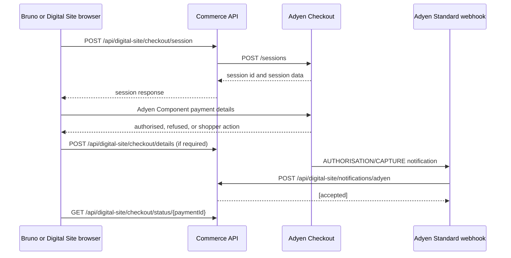

# Adyen Checkout Sessions smoke test

This scenario validates the repository's application boundary for Adyen
Checkout Sessions without exposing Adyen credentials to Bruno or the browser
test collection.

## Flow

## Running it

Open [`tools/adyen/bruno`](../../tools/adyen/bruno) in Bruno, select the
`local` environment, set `crmId` and `cartId`, and run the requests in the
order documented in its README.

The cart must already exist and contain a payable item. The collection does
not create or mutate carts because cart setup is specific to the local
Commerce Tools configuration.

## Configuration boundary

The Commerce API owns the Adyen credential. It can use either:

- direct Adyen Checkout API access using `Adyen__ApiKey`; or
- an APIM endpoint using `Adyen__CheckoutApiUrl` and
  `Adyen__ApimSubscriptionKey`.

The Bruno collection calls only the Commerce API. It must not send
`X-API-Key`, `Ocp-Apim-Subscription-Key`, or `Adyen__HmacKey`.

## Payment state and retries

Creating a session or receiving a successful `/payments/details` response is
not proof that funds were captured. The signed Adyen Standard webhook is the
source of payment state updates. Adyen may retry notifications; the API must
continue to verify each item and preserve duplicate-safe processing.

Any future authorization or capture operation must use an idempotency key
where the Adyen API and SDK support it. This smoke test deliberately does not
add a capture request because capture timing is a business decision and is not
currently part of the checkout API boundary.

## Safety

- Use the Adyen test environment only.
- Never place API keys, HMAC keys, APIM keys, redirect results, or PSP
  references in tracked files.
- Do not run `submit-details` without a real action result from the Adyen
  Component.
- A successful HTTP response is not equivalent to final settlement.
